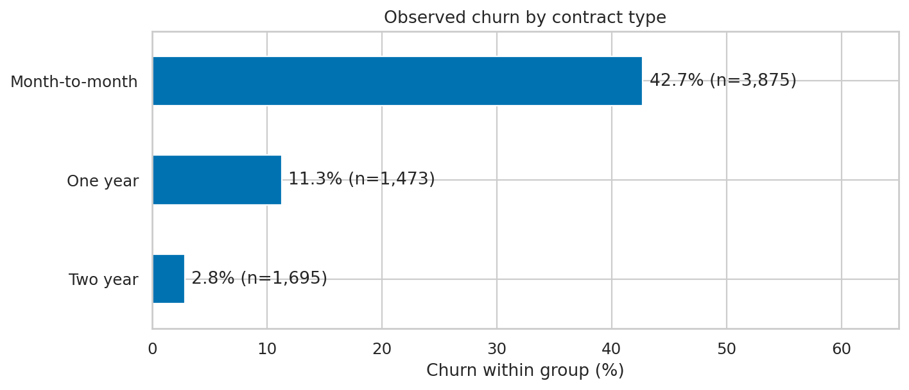
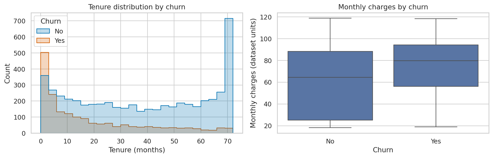
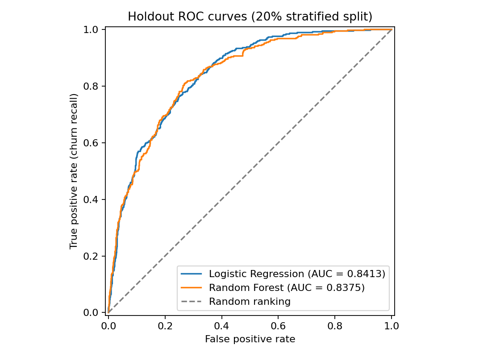
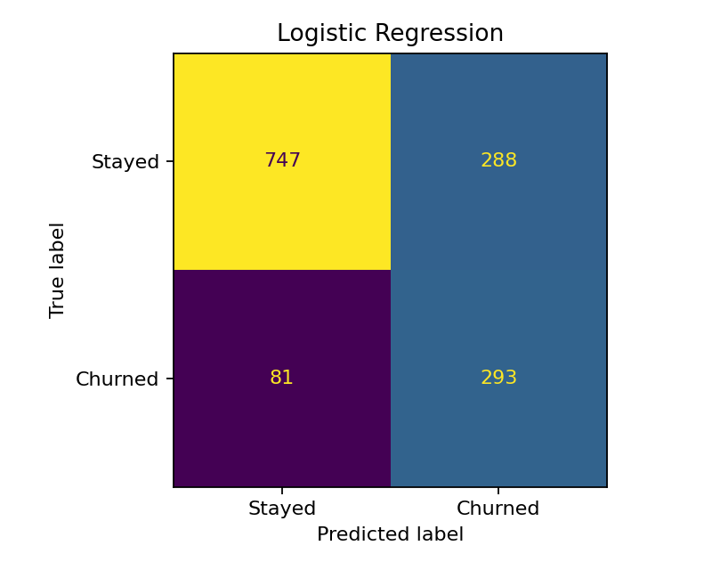
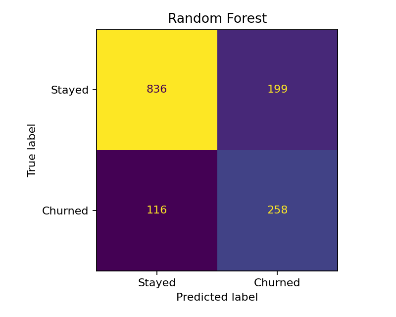

# Customer Churn Prediction

A reproducible machine learning portfolio project that ranks telecom customers by churn risk. It combines an exploratory notebook, leakage-aware model comparison, a saved preprocessing pipeline, batch prediction and automated tests.

## Business problem

Retention teams have limited capacity. A churn ranking can help prioritize customers for further review and retention offers. Missing a churner and contacting a customer who would stay have different costs, so accuracy alone is insufficient. This project demonstrates the workflow; it does not establish that an offer prevents churn.

## Dataset

[IBM Telco Customer Churn sample](https://github.com/IBM/telco-customer-churn-on-icp4d/tree/master/data): **7,043 fictional customers**, 21 columns, including the `Churn` target. Features cover demographics, contracts, services, tenure and billing. The original CSV is retained unchanged in `data/`.

- 1,869 customers churned (**26.54%**); 5,174 stayed.
- 11 blank `TotalCharges` entries become missing numeric values, then are imputed inside training folds.
- No exact duplicate rows or duplicate customer IDs were found.
- `customerID` and `Churn` never enter model features.

The dataset is an educational snapshot, not current production customer data. IBM remains the source of the sample; this project does not claim ownership of the underlying data.

## Technologies and architecture

Python, pandas, NumPy, scikit-learn, matplotlib, seaborn, joblib and Jupyter. Core dependency versions are pinned in `requirements.txt`; runtime versions and the dataset SHA-256 are recorded in the metrics JSON. The complete workflow was validated on Python 3.11.17 and 3.12.14 on Linux (11 tests, training, inference and EDA in each). Python 3.11.5 specifically was not available for execution. Exact metrics below were produced with Python 3.12.14 and scikit-learn 1.5.2 on Linux; Windows execution was not available here.

```text
Customer-Churn-Prediction/
├── data/WA_Fn-UseC_-Telco-Customer-Churn.csv
├── examples/new_customers.csv       # 3 unlabelled rows from the IBM sample
├── notebooks/01_eda.ipynb            # executed EDA with interpretations
├── src/
│   ├── preprocessing.py            # schema validation + train-fitted transforms
│   ├── train.py                    # CV selection, holdout evaluation, artifacts
│   └── predict.py                  # raw CSV → saved pipeline → risk scores
├── models/                         # generated joblib artifact; ignored by Git
├── reports/
│   ├── figures/                    # EDA, ROC and confusion matrix figures
│   └── model_metrics.json          # actual results + experiment provenance
├── tests/test_workflow.py
├── .github/workflows/validate.yml
├── requirements.txt
└── README.md
```

Raw CSV → validate/clean → stratified split → pipeline (imputation, scaling, one-hot encoding, classifier) → training-only cross-validation → selected saved pipeline → raw-input batch inference.

## Installation on Windows (PowerShell)

Run from the existing project directory; do not clone over an existing checkout.

```powershell
# Open PowerShell in your Customer-Churn-Prediction checkout.
py -3.11 -m venv .venv
.\.venv\Scripts\python.exe -m pip install -r requirements.txt
.\.venv\Scripts\python.exe -m pip check
.\.venv\Scripts\python.exe -m unittest discover -s tests -v
.\.venv\Scripts\python.exe src/train.py
.\.venv\Scripts\python.exe src/predict.py --input examples/new_customers.csv --output reports/new_customer_risk_scores.csv
```

If `.venv` already exists, use its interpreter and install the requirements into it; there is no need to recreate it. Explicit interpreter paths avoid PowerShell activation-policy changes.

Linux/macOS equivalent:

```bash
python3 -m venv .venv
source .venv/bin/activate
python -m pip install -r requirements.txt
python -m pip check
python -m unittest discover -s tests -v
python src/train.py
python src/predict.py --input examples/new_customers.csv --output reports/new_customer_risk_scores.csv
```

These commands need no API keys, database or GPU. Training defaults to two forest workers; use `--jobs` to adjust. Run commands from the repository root. `python -m src.train` and `python -m src.predict` also work there.

## Exploratory analysis

Open the notebook with the same environment:

```powershell
.\.venv\Scripts\python.exe -m jupyter lab
```

Or execute it noninteractively without replacing the source notebook:

```powershell
.\.venv\Scripts\python.exe -m jupyter nbconvert --to notebook --execute notebooks/01_eda.ipynb --output 01_eda.executed --output-dir reports --ExecutePreprocessor.timeout=180
```

The notebook retains the original analysis and adds schema checks, missing values, duplicates, descriptive statistics, target balance, contract/internet/payment comparisons, tenure, charges and numeric relationships. Important figures are saved in `reports/figures/`.

Observed sample insights:

- Month-to-month churn is **42.71%**, compared with **11.27%** for one-year and **2.83%** for two-year contracts.
- Fiber-optic churn is **41.89%**, versus **18.96%** for DSL.
- Electronic-check customers have **45.29%** churn; other payment groups range from **15.24% to 19.11%**.
- Median tenure is **10 months** for churned customers and **38 months** for retained customers.
- Median monthly charges are **79.65** for churned customers and **64.43** for retained customers (dataset billing units).

These associations suggest segments to investigate, not causal effects. EDA describes the full sample; no feature search or threshold tuning based on this EDA is claimed as independently validated.




## Training and evaluation protocol

1. Validate the schema and target; remove exact duplicate records and reject conflicting customer IDs.
2. Split **80/20**, stratified by churn, with seed **42**: 5,634 training rows and 1,409 holdout rows.
3. Each pipeline validates/coerces numeric data, imputes numeric medians and categorical modes, scales numeric features, and one-hot encodes categories. Transformations are fitted only on the training partition of each fold. New categorical levels are ignored by the encoder; required missing columns are rejected.
4. Compare balanced Logistic Regression (`max_iter=2000`) and balanced Random Forest (400 trees, `min_samples_leaf=3`). Use three shuffled stratified training folds with seed 42. Select the model with the highest **mean CV ROC-AUC before evaluating the holdout**.
5. Evaluate both fixed candidates on the same holdout at classification threshold **0.5**. Save the selected training-fitted model; do not refit using holdout labels.

ROC-AUC measures ranking across thresholds. Retention costs and a contact budget are not provided, so it is a transparent model-selection criterion; it is not a profit estimate. The test-set majority-class baseline is **73.46% accuracy with 0% churn recall**, illustrating why accuracy alone is misleading.

### Executed results

All values below come from `reports/model_metrics.json`; higher is better for these metrics.

| Model | Mean CV ROC-AUC | Test accuracy | Test precision | Test recall | Test F1 | Test ROC-AUC |
|---|---:|---:|---:|---:|---:|---:|
| Logistic Regression | 0.8457 | 0.7381 | 0.5043 | 0.7834 | 0.6136 | 0.8413 |
| Random Forest | 0.8406 | 0.7764 | 0.5646 | 0.6898 | 0.6209 | 0.8375 |

**Selected: Logistic Regression.** It has higher training-only CV ROC-AUC and higher holdout ROC-AUC and churn recall. Random Forest has higher precision, F1 and accuracy at threshold 0.5. The small AUC difference is not proof of statistical superiority; a different contact budget or error-cost objective could favor a different operating point.

The metrics JSON also contains fold scores, their standard deviation, both confusion matrices and full classification reports. Training rejects output paths that would overwrite the source dataset or collide with report files. The selected model is saved to `models/churn_pipeline.joblib`, and a reload/prediction equivalence check runs during training.





## Predicting new customers

Input must contain the same 19 feature columns as `examples/new_customers.csv`. `customerID` is optional (row numbers are used if absent); `Churn` is optional and ignored. Additional columns are ignored. Blank numeric cells are imputed; nonblank malformed, negative or infinite numeric values fail with a clear error. `SeniorCitizen` must be 0 or 1 when supplied. Blank categories are imputed; previously unseen categories are accepted. Customer IDs are read as strings to preserve leading zeros.

```powershell
.\.venv\Scripts\python.exe src/predict.py --input data/WA_Fn-UseC_-Telco-Customer-Churn.csv --output reports/customer_risk_scores.csv
```

Example output for the three sample rows, generated by the selected model. These rows come from the source dataset and may have been used in training; this demonstrates the CLI, not independent validation:

```csv
customerID,churn_probability,risk_band,retention_priority
7590-VHVEG,0.8021,High,Contact immediately
5575-GNVDE,0.119,Low,Monitor
3668-QPYBK,0.5319,Medium,Targeted offer
```

Risk bands use full-precision model scores: **Low < 0.40**, **Medium 0.40–<0.70**, **High ≥ 0.70**. CSV probabilities are rounded to four decimal places. These are illustrative workflow labels, not calibrated business thresholds or proven optimal interventions. The 0.5 evaluation threshold and risk-band cutoffs serve different purposes.

The CLI reports missing files, required columns, empty inputs and invalid numeric values and exits with code 2. It prevents overwriting the input or model path. Existing output CSVs are replaced on success, so preserve prior reports if needed. Load only trusted joblib artifacts: pickle-based loading can execute code. Keep the `src` package available and use the training dependency versions when loading a model.

## Tests and reproducibility

```bash
python -m unittest discover -s tests -v
```

Eleven automated tests cover identifier/target exclusion, training-only imputation statistics, missing values, unknown categories, invalid schema/numerics, training labels and duplicate IDs, risk boundaries, optional IDs, serialization and real CLI batch inference. The CLI tests also preserve leading-zero customer IDs, reject non-predictive model artifacts, and prevent training outputs from overwriting the dataset or each other. The batch CLI test runs from outside the repository, checks probabilities and verifies that invalid input does not replace an existing output.

The [published GitHub Actions run](https://github.com/zhandarkayirbay/Customer-Churn-Prediction/actions/runs/38747462360) passed installation, the original eight tests, training, prediction and notebook execution on Ubuntu with Python 3.11 and 3.12 for commit `f1deeeb518d88ee28aa99206c05a0b82a85d21da`. The updated workflow adds Windows to both Python versions and runs the expanded 11-test suite; these Windows jobs are pending publication and execution. Windows compatibility is not yet verified. See `reports/final_audit.md` for the audit evidence and remaining checks.

Reviewable outputs include the executed EDA notebook, figures and metrics JSON. Generated joblib files and customer score CSVs are ignored by Git and can be reproduced using the commands above. Core packages are pinned; transitive Jupyter dependencies are not fully locked. Exact training versions are recorded alongside the results.

## Limitations and future improvements

- Fictional, cross-sectional sample; no temporal or external validation and no production deployment claim. Feature timestamps and a prospective prediction horizon are unavailable.
- Balanced class weights affect probability calibration. Validate calibration on a separate training validation partition before interpreting scores as absolute probabilities.
- No hyperparameter optimization or threshold/cost tuning was performed. The current holdout and full-sample EDA have already been inspected during development; these are benchmark scores, not a blinded external estimate. Future tuning needs training-only validation and a new untouched external or temporal test set.
- No confidence intervals, fairness audit, intervention experiment or drift monitoring. Demographic features require careful review before real-world use.
- Numeric validation prevents obvious malformed inputs but does not enforce every domain-specific service combination.
- AUC differences are small; repeated CV and uncertainty estimates would strengthen comparison.
- Plain CSV is intended for small batch scoring; no web service or dashboard is required for this portfolio scope.

Before committing, review the notebook, report figures, metrics and Git diff. Do not commit real customer records, credentials or untrusted binary artifacts. Predictions should support human decisions rather than automatically determine treatment.
